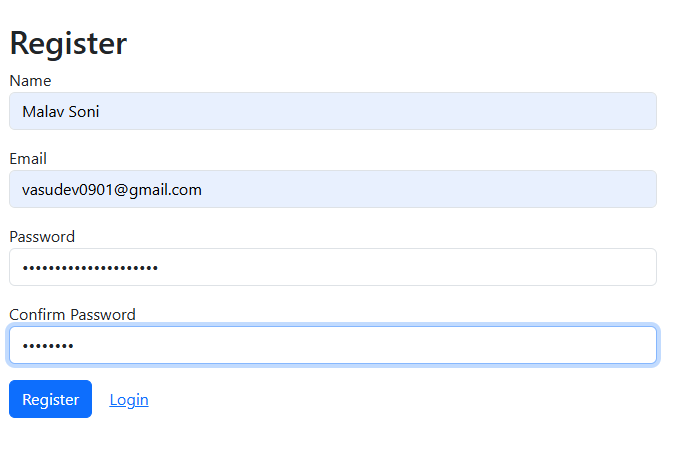
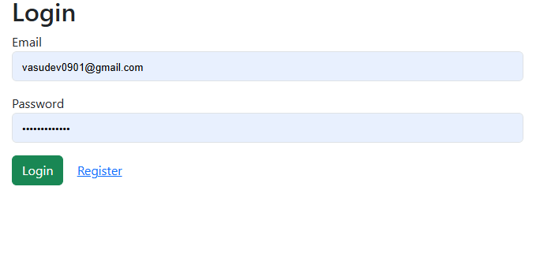
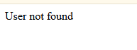

# 📝 Blog Application

name: patadiya mihir 

project details: 

A complete and lightweight Node.js web application with User Registration, Authentication (Cookie & bcrypt), and Protected Routes.

---

## 📸 Output / Screenshots

| Register Page | Login Page |
| :---: | :---: |
|  |  |

| Protected Blogs Page |
| :---: |
|  |

---

## 🛠️ Tech Stack

- **Backend:** Node.js, Express.js
- **Database:** MongoDB, Mongoose
- **Template Engine:** EJS
- **Authentication & Security:** Cookie Parser, bcryptjs / bcrypt
- **Environment Management:** dotenv

---

## 📂 Project Structure

```text
BLOG_PROJECT/
├── middleware/
│   └── authMiddleware.js    # Cookie authentication verification
├── models/
│   ├── blog.js              # Mongoose blog schema & model
│   └── User.js              # Mongoose user schema & model
├── public/
│   ├── css/
│   │   └── style.css        # Frontend stylesheet
│   └── images/              # Output screenshots
│       ├── blogs.png
│       ├── login.png
│       └── register.png
├── routes/
│   ├── authRoutes.js        # Authentication endpoints (Register/Login/Logout)
│   └── blogRoutes.js        # Protected Blog endpoints
├── views/
│   ├── register.ejs         # User registration page
│   ├── login.ejs            # User login page
│   └── blogs.ejs            # Protected blogs dashboard/feed
├── .env                     # Environment variables
├── app.js                   # Application entry point
├── package.json             # Dependencies and project metadata
└── README.md                # Project documentation